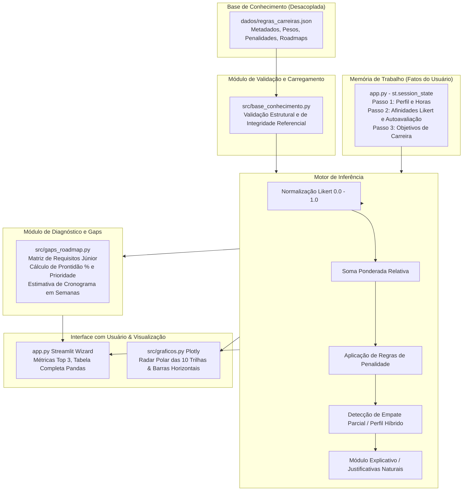

# Consultor Avançado de Carreiras em TI
### Sistema Especialista Baseado em Regras com Tratamento de Incerteza e Pontuação Ponderada

[](https://www.python.org/)
[](https://streamlit.io/)
[](https://pytest.org/)
[]()

> **Trabalho acadêmico desenvolvido para a disciplina de Inteligência Artificial**  
> **Instituição:** Centro Universitário Presidente Antônio Carlos (UNIPAC Barbacena)  
> **Curso:** Ciência da Computação  
> **Docente:** Prof. Felipe Roncalli de Paula Carneiro  
> **Discente / Autor:** Taagny Augusto  
> **Repositório:** [github.com/taagny/Sistema-Especialista-Inteligente-TI](https://github.com/taagny/Sistema-Especialista-Inteligente-TI.git)

---

## 📌 Sumário

1. [Visão Geral & Motivação](#-visão-geral--motivação)
2. [Arquitetura do Sistema Especialista](#-arquitetura-do-sistema-especialista)
3. [As 10 Trilhas Profissionais Modeladas](#-as-10-trilhas-profissionais-modeladas)
4. [Fundamentação Matemática do Motor de Inferência](#-fundamentação-matemática-do-motor-de-inferência)
5. [Diagnóstico de Skill Gaps e Roadmap Júnior](#-diagnóstico-de-skill-gaps-e-roadmap-júnior)
6. [Estrutura do Repositório](#-estrutura-do-repositório)
7. [Como Instalar e Executar](#-como-instalar-e-executar)
8. [Suíte de Testes Automatizados](#-suíte-de-testes-automatizados)
9. [Roteiro Prático de Demonstração](#-roteiro-prático-de-demonstração)
10. [Limitações Conhecidas e Próximos Passos](#-limitações-conhecidas-e-próximos-passos)

---

## 🎯 Visão Geral & Motivação

O mercado de Tecnologia da Informação é amplo, dinâmico e multifacetado. Para estudantes no início ou meio da graduação, bem como profissionais em transição de carreira, identificar qual especialidade seguir costuma envolver incertezas e expectativas desalinhadas.

Neste trabalho prático, optei por projetar e implementar um **Sistema Especialista Baseado em Regras** completo em Python. Diferente de questionários vocacionais genéricos, o sistema:
- Trata **incerteza e subjetividade** por meio de preferências capturadas em escala Likert (1 a 5) ponderadas matricialmente.
- Aplica **regras de conflito lógicas (penalidades)** quando respostas revelam contradição técnica em relação aos fundamentos da área (por exemplo, desejar atuar em Front-end sem interesse em usabilidade visual, ou almejar Back-end com forte aversão a raciocínio algorítmico).
- Identifica **empates parciais / perfis híbridos** quando a distância euclidiana/relativa entre as primeiras posições é inferior a uma margem de tolerância (3%), evitando rankings artificiais.
- Gera **justificativas naturais** para explicar a dedução do sistema.
- Diagnostica **lacunas práticas (*skill gaps*)** comparando a autoavaliação prática do estudante com a matriz de competências exigidas para o nível Júnior da trilha vencedora.
- Monta um **plano de ação cronometrado (Roadmap)** com tecnologias prioritárias, certificações de mercado e sugestões de projetos de portfólio para o GitHub.

### Por que um Motor Próprio?
Por razões de compatibilidade técnica com as versões modernas do ecossistema Python (Python 3.10+ a 3.14), optei por não utilizar bibliotecas legadas como *Experta* (antiga pyknow, descontinuada e incompatível com versões recentes do interpretador). Em vez disso, implementei um **motor determinístico baseado em somas ponderadas normalizadas, matriz de pesos desacoplada em JSON e penalidades com operadores relacionais**.

---

## 🏛️ Arquitetura do Sistema Especialista

O projeto segue rigorosamente o modelo clássico de Sistemas Especialistas da Inteligência Artificial:



---

## 🗺️ As 10 Trilhas Profissionais Modeladas

A base de conhecimento cobre 10 grandes especialidades da indústria de TI:

| Trilha | Foco Central de Atuação | Competências-Chave de Entrada | Exemplo de Certificação Real |
| :--- | :--- | :--- | :--- |
| **Desenvolvimento Back-end** | APIs REST, regras de negócio, modelagem de dados e escalabilidade | Python, SQL, APIs REST, Git, Testes | AWS Cloud Practitioner / GitHub Foundations |
| **Desenvolvimento Front-end & UX** | Interfaces web reativas, design system, experiência do usuário | HTML/CSS/JS, Git, APIs REST | Meta Front-End Developer |
| **Ciência de Dados** | Modelagem preditiva, análise estatística e Machine Learning | Python, Estatística, SQL, Scikit-Learn | Google Data Analytics / Databricks Associate |
| **Engenharia de Dados** | Pipelines de ingestão (ETL), Data Warehouses e orquestração | SQL avançado, Python, Linux, Docker | Azure Data Engineer (DP-203) / Databricks |
| **Cibersegurança** | Defesa de perímetro, análise de vulnerabilidades, redes e logs | Linux, Redes, Scripting, Segurança | CompTIA Security+ / ISC2 CC |
| **DevOps / Confiabilidade (SRE)** | CI/CD, infraestrutura como código, observabilidade e containers | Linux, Docker, Git, Nuvem, Shell Script | GitHub Actions / Kubernetes KCNA ou CKA |
| **Arquitetura & Engenharia Cloud** | Desenho de topologias em nuvem resilientes, seguras e distribuídas | Nuvem (AWS/Azure/GCP), Linux, Docker | AWS Solutions Architect Associate / Azure AZ-900 |
| **Desenvolvimento Mobile** | Apps para Android e iOS, interfaces táteis e consumo offline | Mobile (Flutter/React Native), APIs, Git | Meta React Native Specialization |
| **Garantia da Qualidade (QA)** | Testes automatizados (E2E e contratos), prevenção de defeitos | Testes automatizados, Git, APIs, SQL | ISTQB CTFL (Foundation Level) |
| **Gestão de Produtos (PM)** | Descoberta contínua, métricas de negócio, priorização e liderança | Métricas de negócio, SQL analítico, Ágil | Scrum.org PSPO I / Product School |

---

## 🧮 Fundamentação Matemática do Motor de Inferência

O motor de inferência opera como um pipeline de funções matemáticas puras:

### 1. Normalização dos Fatos (Escala Likert)
Para que todas as respostas Likert $R_i \in \{1, 2, 3, 4, 5\}$ tenham escala compatível com os pesos, realiza-se uma transformação afim para o intervalo contínuo $[0.0, 1.0]$:

$$N_i = \frac{R_i - 1}{4}$$

- $R_i = 1 \implies N_i = 0.0$ *(Nenhuma afinidade)*
- $R_i = 3 \implies N_i = 0.5$ *(Afinidade moderada / neutro)*
- $R_i = 5 \implies N_i = 1.0$ *(Afinidade total)*

### 2. Compatibilidade Base Ponderada (Tratamento de Dados Incompletos)
Cada trilha $T$ possui um conjunto de pesos $P = \{(q_1, w_1), (q_2, w_2), \dots, (q_m, w_m)\}$ com $w_i \in [1, 10]$.

Para evitar que perguntas eventualmente não respondidas zerem ou prejudiquem indevidamente a trilha, a compatibilidade percentual base é calculada **estritamente sobre o subconjunto de perguntas respondidas que possuem peso na trilha**:

$$C_{\text{base}}(T) = \left( \frac{\sum_{i \in \text{respondidas}(T)} (N_i \times w_i)}{\sum_{i \in \text{respondidas}(T)} w_i} \right) \times 100$$

Se nenhuma pergunta da trilha tiver sido respondida, $C_{\text{base}} = 0.0\%$.

### 3. Aplicação de Regras de Conflito (Penalidades)
Se o usuário assinalar uma resposta incompatível com a natureza da trilha, uma dedução direta em pontos percentuais é subtraída da compatibilidade base:

$$\text{Penalidade Total} = \sum_{k \in \text{conflitos disparados}} \text{penalidade}_k$$

A compatibilidade líquida final é garantida no intervalo $[0.0, 100.0]$:

$$P_{\text{final}}(T) = \max\left(0.0, \min\left(100.0, C_{\text{base}}(T) - \text{Penalidade Total}\right)\right)$$

### 4. Exemplo Numérico Passo a Passo

Considere a avaliação da trilha de **Desenvolvimento Back-end**, cujos pesos na base são:
- `logica_algoritmos`: peso 10
- `banco_dados`: peso 10
- `automacao_scripts`: peso 6
- `testes_qualidade`: peso 6
- `infra_servidores`: peso 4
- `preferencia_remoto`: peso 5
- `busca_retorno_rapido`: peso 5

Suponha que um estudante forneça:
- `logica_algoritmos` = 5 $\implies N = 1.00$
- `banco_dados` = 4 $\implies N = 0.75$
- `automacao_scripts` = 4 $\implies N = 0.75$
- `testes_qualidade` = 3 $\implies N = 0.50$
- `infra_servidores` = 3 $\implies N = 0.50$
- `preferencia_remoto` = 5 $\implies N = 1.00$
- `busca_retorno_rapido` = 4 $\implies N = 0.75$

**Cálculo dos pontos obtidos:**
$$\text{Pontos} = (1.00 \times 10) + (0.75 \times 10) + (0.75 \times 6) + (0.50 \times 6) + (0.50 \times 4) + (1.00 \times 5) + (0.75 \times 5)$$
$$\text{Pontos} = 10.0 + 7.5 + 4.5 + 3.0 + 2.0 + 5.0 + 3.75 = 35.75$$

**Soma dos pesos possíveis:**
$$\text{Peso Total} = 10 + 10 + 6 + 6 + 4 + 5 + 5 = 46.0$$

**Compatibilidade base:**
$$C_{\text{base}} = \left( \frac{35.75}{46.0} \right) \times 100 \approx 77.7\%$$

Como nenhuma regra de conflito foi ativada (lógica $\ge 3$ e banco $\ge 2$), a pontuação final é **77.7%**.

### 5. Detecção de Empate Técnico (Perfil Híbrido)
Se entre o 1º e o 2º lugar (ou 2º e 3º) a diferença absoluta de pontuação for menor ou igual à tolerância:

$$\Delta = |P_{\text{final}}(T_a) - P_{\text{final}}(T_b)| \le 3.0\%$$

O sistema ativa o marcador `empate_parcial = True` e emite uma mensagem explicativa de perfil multidisciplinar.

---

## 📈 Diagnóstico de Skill Gaps e Roadmap Júnior

Além da recomendação de compatibilidade de perfil, o sistema diagnostica a distância prática entre o conhecimento atual do estudante e o mercado de trabalho:

### 1. Índice de Prontidão Técnica para Júnior
Para cada competência exigida no nível Júnior da trilha vencedora (nível mínimo $N_{\text{min}} \in \{1, 2, 3\}$ e peso de relevância $W_j$):

$$\text{Prontidão}_{\text{Júnior}} (\%) = \left( \frac{\sum_j \min(N_{\text{atual}, j}, N_{\text{min}, j}) \times W_j}{\sum_j N_{\text{min}, j} \times W_j} \right) \times 100$$

### 2. Priorização de Lacunas (*Gaps*)
Para ordenar as competências que o aluno deve estudar primeiro:

$$\text{Lacuna}_j = \max(0, N_{\text{min}, j} - N_{\text{atual}, j})$$
$$\text{Prioridade}_j = \text{Lacuna}_j \times W_j$$

As lacunas são organizadas em ordem estritamente decrescente de prioridade.

### 3. Estimativa de Cronograma de Estudos
Adotando como referência empírica que avançar 1 nível prático em uma competência técnica consome em média 40 horas de estudo aplicado:

$$\text{Horas Totais Necessárias} = \sum_j \text{Lacuna}_j \times 40\text{h}$$
$$\text{Semanas Estimadas} = \left\lceil \frac{\text{Horas Totais Necessárias}}{H_{\text{semanais informadas}}} \right\rceil$$

---

## 📂 Estrutura do Repositório

```text
Sistema-Especialista-Inteligente-TI/
├── app.py                      # Interface Streamlit (Wizard com 3 passos + tela de diagnóstico)
├── dados/
│   └── regras_carreiras.json   # Base de conhecimento declarativa (perguntas, pesos, penalidades e roadmaps)
├── src/
│   ├── __init__.py
│   ├── base_conhecimento.py    # Carregador e validador semântico da base JSON
│   ├── motor_inferencia.py     # Motor matemático: normalização, penalidades, ranking e empates
│   ├── gaps_roadmap.py         # Diagnóstico de lacunas técnicas e estimativa cronológica
│   └── graficos.py             # Visualizações com Plotly (gráfico polar radar e barras horizontais)
├── testes/
│   ├── test_motor.py           # Testes unitários do motor de inferência
│   ├── test_gaps_roadmap.py    # Testes unitários da análise de gaps e roadmap
│   └── test_casos_limite.py    # 10 testes de robustez e perfis limítrofes
├── docs/
│   └── relatorio_testes.md     # Relatório analítico detalhado com resultados dos 10 casos limite
├── requirements.txt            # Dependências oficiais (streamlit, pandas, plotly, pytest)
├── pytest.ini                  # Configuração de descoberta de testes e pythonpath
├── .gitignore                  # Arquivos desconsiderados no git (venv, caches, logs)
└── README.md                   # Documentação detalhada do projeto
```

---

## 💻 Como Instalar e Executar

### Pré-requisitos
- **Python 3.10 ou superior** instalado.
- **Git** instalado.

### 1. Clonar o Repositório
```bash
git clone https://github.com/taagny/Sistema-Especialista-Inteligente-TI.git
cd Sistema-Especialista-Inteligente-TI
```

### 2. Criar e Ativar o Ambiente Virtual
- **No Windows (PowerShell):**
  ```powershell
  python -m venv .venv
  .venv\Scripts\Activate.ps1
  ```
- **No Linux ou macOS:**
  ```bash
  python3 -m venv .venv
  source .venv/bin/activate
  ```

### 3. Instalar as Dependências
```bash
pip install -r requirements.txt
```

### 4. Executar a Aplicação Web
```bash
streamlit run app.py
```
O Streamlit iniciará o servidor local e abrirá a aplicação em seu navegador padrão em:  
👉 **`http://localhost:8501`**

### 5. Executar os Testes Automatizados
```bash
pytest -v
```

---

## 🧪 Suíte de Testes Automatizados

O projeto conta com **21 testes automatizados**, todos integrados ao `pytest`:

1. **`testes/test_motor.py` (7 testes)**:
   - Validação da normalização Likert (extremos 1 e 5, ponto médio 3).
   - Tratamento de exceção para valores inválidos (0, 6, textos).
   - Teste de trilha dominante óbvia (Front-end com notas máximas em design).
   - Aplicação e cálculo de penalidades lógicas.
   - Tratamento justo de respostas parciais.
   - Detecção de empate técnico / perfil híbrido.
   - Geração de textos explicativos em linguagem natural.
2. **`testes/test_gaps_roadmap.py` (4 testes)**:
   - Usuário iniciante absoluto (prontidão 0%, estimativa de tempo total e certificação inicial).
   - Usuário experiente (prontidão 100%, 0 gaps e orientação para nível Pleno).
   - Ordenação das lacunas prioritárias pelo produto $\text{Lacuna} \times \text{Peso}$.
   - Proporcionalidade da estimativa em semanas ao variar as horas semanais.
3. **`testes/test_casos_limite.py` (10 testes)**:
   - 10 cenários de estresse analiticamente documentados em [`docs/relatorio_testes.md`](docs/relatorio_testes.md).

---

## 🎬 Roteiro Prático de Demonstração

Para apresentar a aplicação de forma rápida e convincente:

### Cenário 1: O Desenvolvedor Front-end Nato
- **Passo 1:** 10 horas semanais, inglês intermediário.
- **Passo 2:**
  - `design_visual_ux`: 5 *(Total)*
  - `trabalho_criativo_visual`: 5 *(Total)*
  - `infra_servidores` e `redes_seguranca`: 1 *(Nenhuma)*
  - Autoavaliação: HTML/CSS/JS = 1, Git = 1, Python = 0.
- **Passo 3:** Trabalho criativo alto.
- **Resultado Esperado:** **Front-end & UX** em 1º lugar isolado (> 85%), Back-end com penalidade por falta de afinidade visual/lógica, e diagnóstico indicando prontidão de ~35% para nível Júnior com plano de estudo focado em JavaScript ES6+ e React.

### Cenário 2: O Perfil Híbrido (Empate Técnico entre Dados e Back-end)
- **Passo 2:**
  - `logica_algoritmos`: 5
  - `banco_dados`: 5
  - `matematica_estatistica`: 4
  - `ia_machine_learning`: 4
  - `automacao_scripts`: 4
- **Resultado Esperado:** O sistema exibirá o alerta destacado de **💡 Perfil Híbrido Detectado**, apontando empate entre **Ciência de Dados** e **Engenharia de Dados** (diferença de apenas ~1.7%), com Back-end logo em seguida no Top 3.

### Cenário 3: O Engenheiro DevOps / Confiabilidade
- **Passo 2:**
  - `infra_servidores`: 5
  - `automacao_scripts`: 5
  - `resolucao_pressao`: 5
  - `redes_seguranca`: 4
  - `design_visual_ux`: 1
- **Resultado Esperado:** Top 3 dominado por **DevOps & Confiabilidade (SRE)**, **Cibersegurança** e **Arquitetura Cloud**, com Front-end sofrendo severa penalidade por falta de afinidade visual.

---

## 🔮 Limitações Conhecidas e Próximos Passos

- **Aprofundamento em Soft Skills**: O modelo atual foca prioritariamente em habilidades técnicas e objetivos de rotina. Uma futura expansão pode incluir um módulo complementar de traços comportamentais (Big Five / DISC) para refinar trilhas de liderança técnica e gestão de produtos.
- **Integração com Vagas em Tempo Real**: Conectar o motor a APIs de empregos abertos (como LinkedIn ou Glassdoor) para correlacionar os *skill gaps* com o volume de vagas ativas no Brasil e no exterior.
- **Exportação do Diagnóstico em PDF**: Permitir o download de um relatório executivo com o radar de competências e o plano de estudos gerado em PDF.

---

## 📄 Licença e Autoria

Este projeto é de código aberto sob licença MIT. Desenvolvido para fins exclusivamente educacionais e acadêmicos como parte da avaliação da disciplina de **Inteligência Artificial** do curso de **Ciência da Computação** da **UNIPAC Barbacena**.

**Autor:** Taagny Augusto  
**Orientador:** Prof. Felipe Roncalli de Paula Carneiro
